# Secure Small Office Network

My Packet Tracer project for the Cisco Intro to Cybersecurity course. I built a small office network, split it into VLANs, stopped the Guest network from reaching the internal machines, and locked down the switch and router a bit. I'm adding a Nmap scan of my home network next.

Tools: Cisco Packet Tracer 9.0.1

## Layout

| VLAN | Name | Subnet | Gateway |
|------|------|--------|---------|
| 10 | Staff | 192.168.10.0/24 | 192.168.10.1 |
| 20 | Guest | 192.168.20.0/24 | 192.168.20.1 |
| 30 | Servers | 192.168.30.0/24 | 192.168.30.1 |
| 99 | Management | 192.168.99.0/24 | 192.168.99.1 |

One router, one switch, two Staff PCs, two Guest PCs and a server. Everything has a static IP.

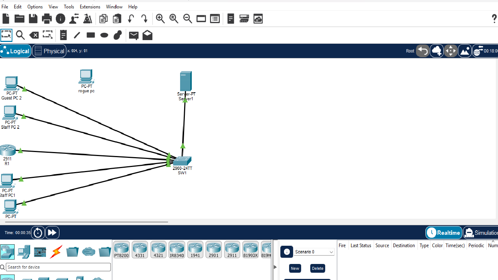

## VLANs and routing

I made the four VLANs on the switch, put the PCs on access ports and set up a trunk to the router. The router has one subinterface per VLAN, so all the routing goes through that single cable.

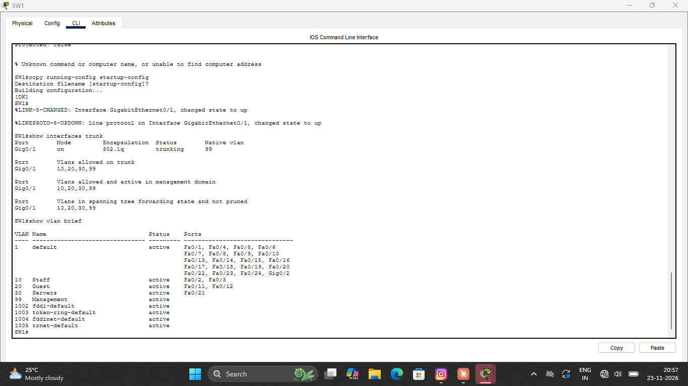
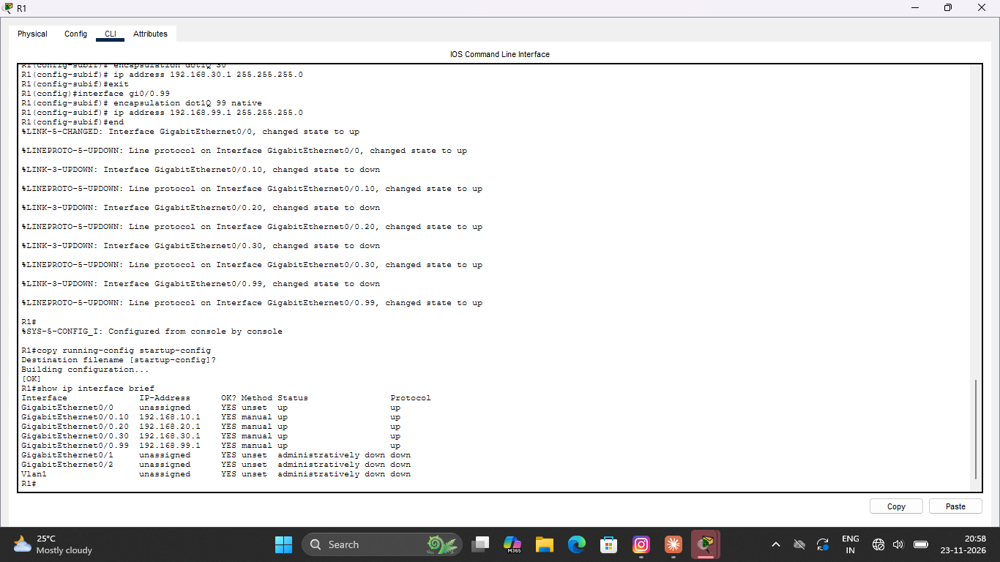
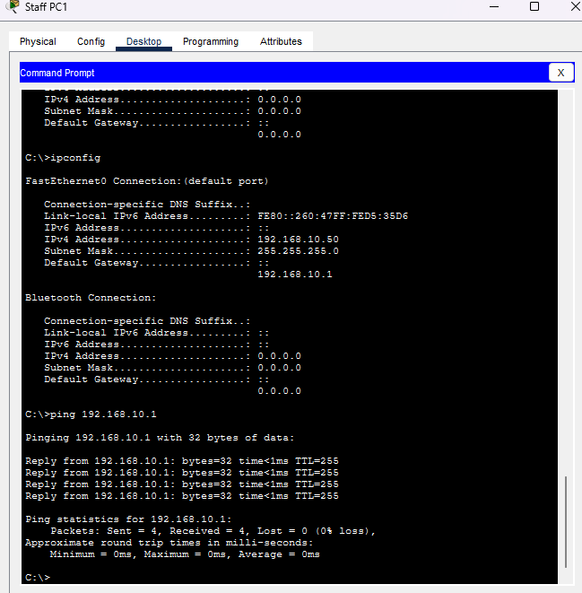

## Guest ACL

At first a Guest PC could ping the server, which is what I didn't want:

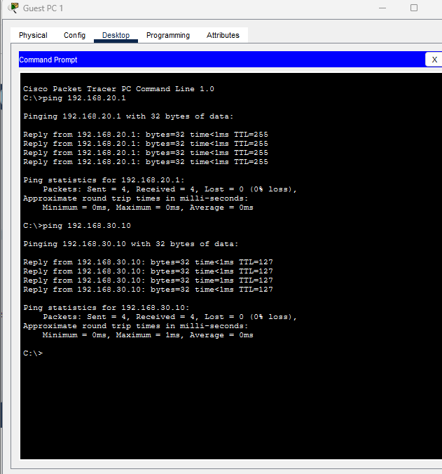

So I wrote an ACL called GUEST_IN and put it inbound on the Guest subinterface. It blocks Guest traffic to Staff, Servers and Management. After that Guest could still ping its own gateway but not the server or the Staff PC.

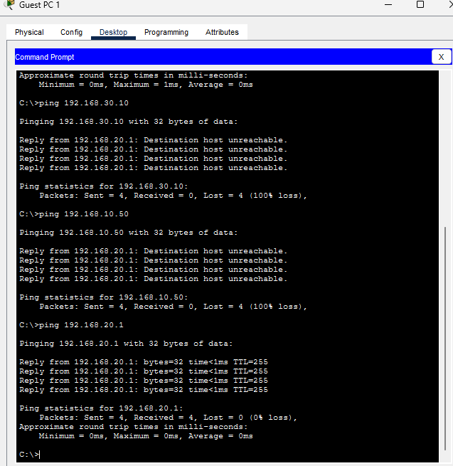
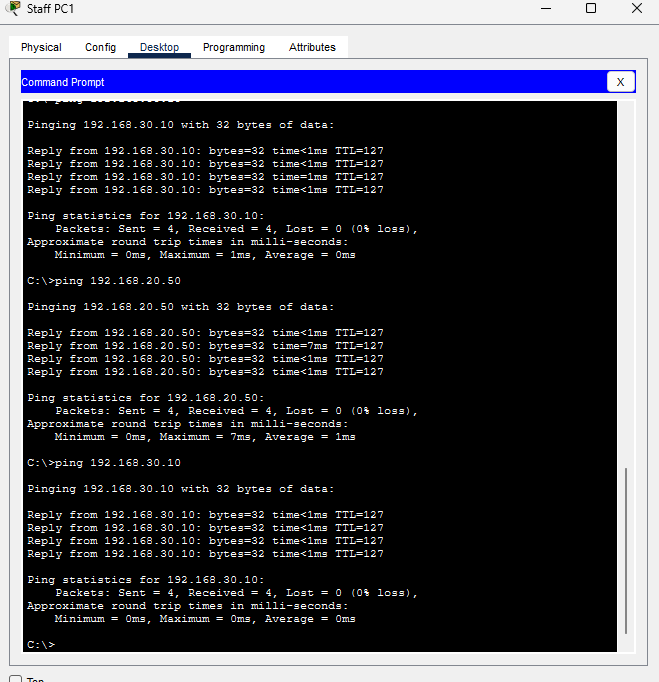
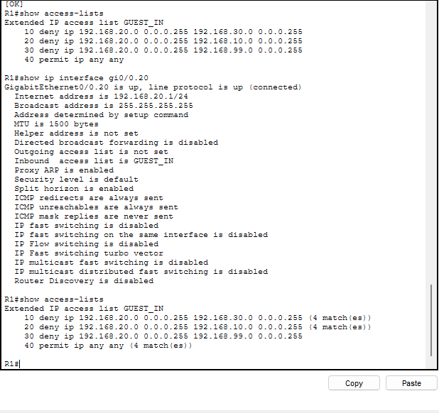

## Switch port security

Every used port allows one device, remembers its MAC address and shuts down if a different device shows up. I also turned off all the ports I'm not using.

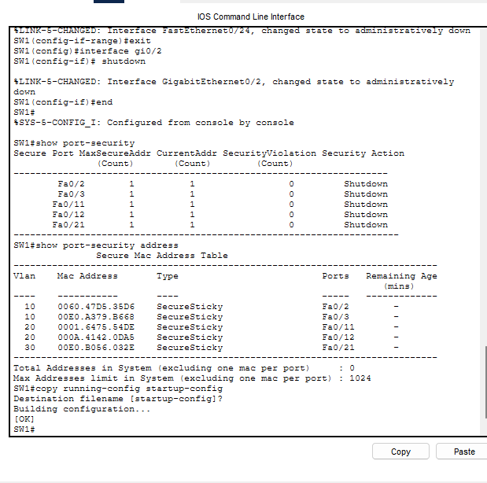

To test it I put a rogue PC on one of the protected ports. The port went into err-disabled and the violation count went to 1.

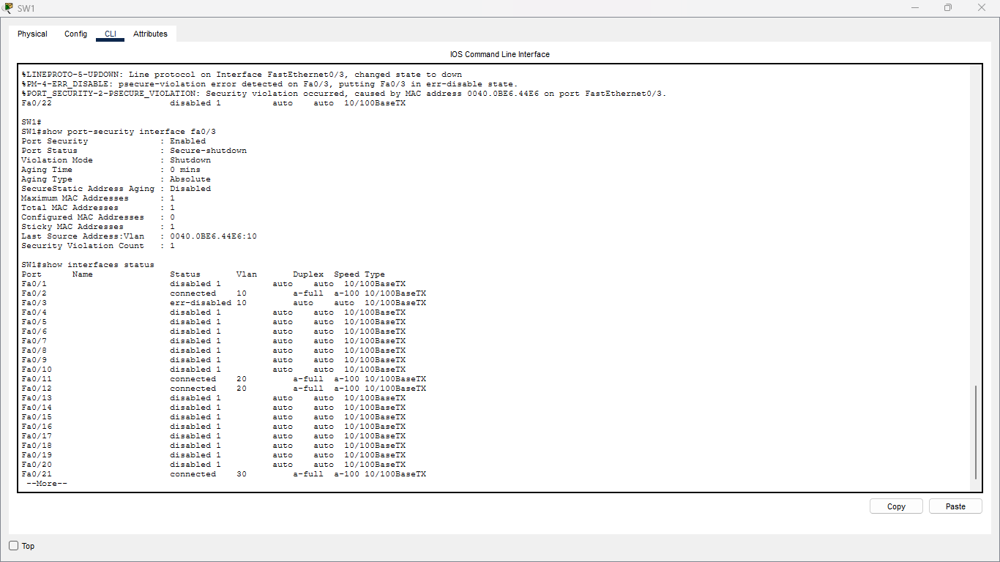
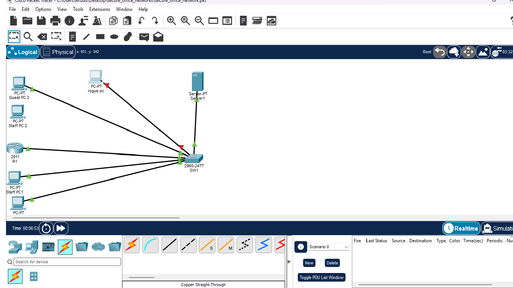

## Router login

On the router I set hashed passwords and a login banner, turned on SSH and turned Telnet off. Only the Staff network is allowed to log in remotely.

SSH from a Staff PC works and shows the banner:

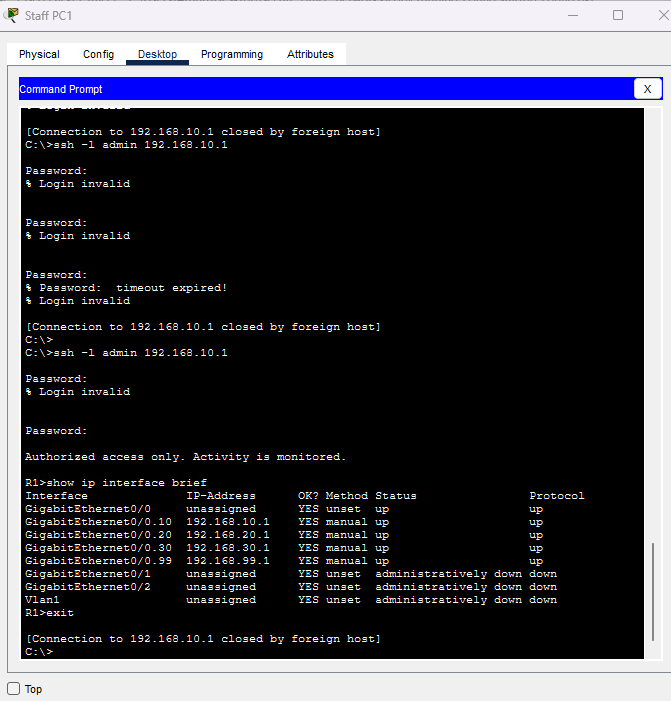

From a Guest PC the connection is refused:

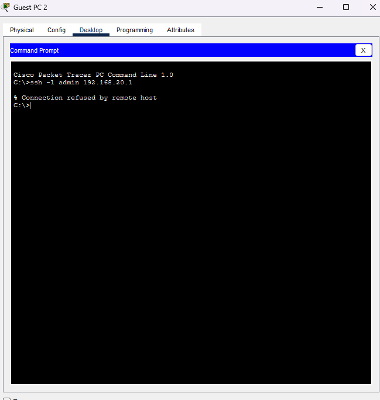

SSH is enabled, version 2:

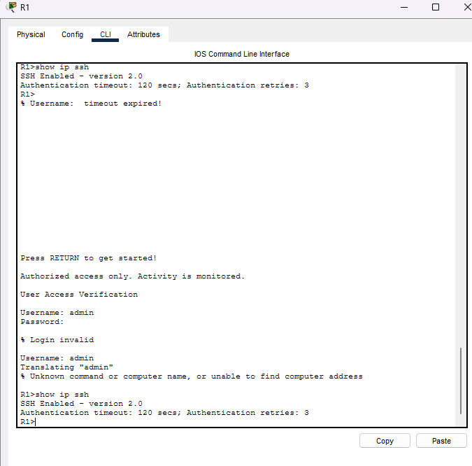

## Things that went wrong

* Commands kept getting rejected because I was in user mode and forgot `enable` and `configure terminal`.
* One PC couldn't reach its gateway even though the switch port was up. Deleting and redrawing the cable fixed it.
* I set up DHCP on the router but the PCs never got an address, so I used static IPs. I never found out why.
* One PC had the wrong mask and gateway. Pinging inside the same VLAN still worked, so I only caught it from `ipconfig`.

## Not finished

* DHCP
* SSH and a management IP on the switch
* DHCP snooping
* It was all done in a simulator, not on real equipment

## Next

A Nmap scan and a look at my home router's settings, with before and after results.

## Files

* `secure_office_network.pkt` is the lab file
* `screenshots` has the proof for each step
* `configs` has the commands I used on the router and switch. I wrote these up from my notes, they aren't exported configs.
